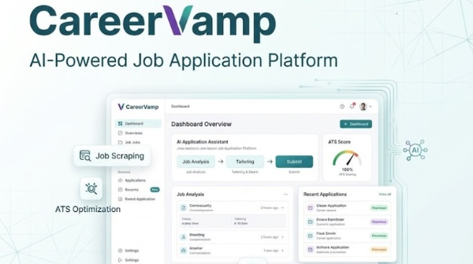
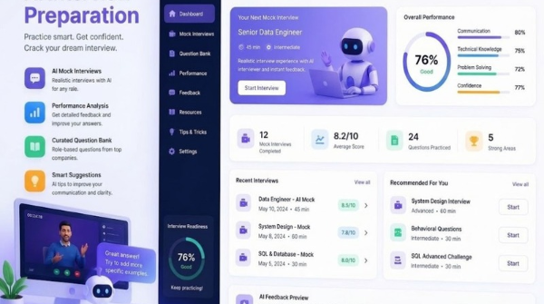
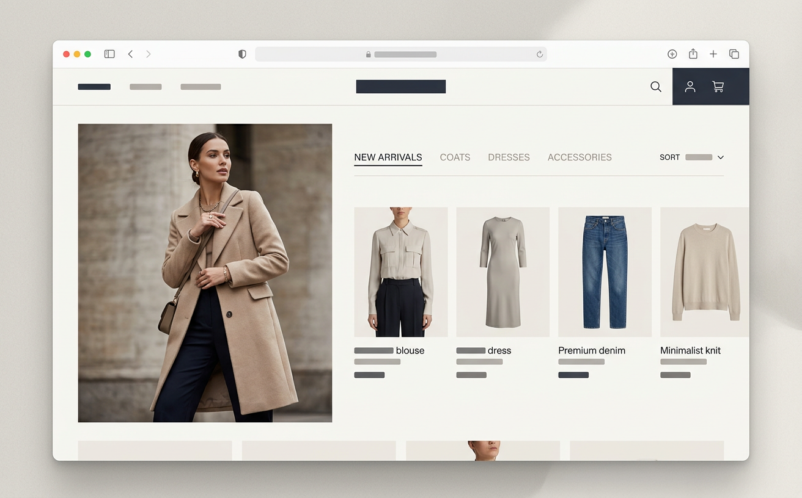

# Muhammad Bilal

## AI Application Developer | Python Backend Engineer

I build practical AI-powered applications, integrate large language models into products, and develop reliable Python backend systems.

- **Portfolio:** [muhammadbilal-lime.vercel.app](https://muhammadbilal-lime.vercel.app/)
- **LinkedIn:** [bilal-fullstack](https://www.linkedin.com/in/bilal-fullstack)
- **GitHub:** [bilalchawdhary1](https://github.com/bilalchawdhary1)
- **Email:** [chbilalc627@gmail.com](mailto:chbilalc627@gmail.com)

> Deployment note: the configured portfolio URL returned HTTP 404 during the latest repository audit. Verify the deployment or update the URL before sharing this README publicly.

## About

I work across AI application development and backend engineering, from LLM integrations and intelligent workflows to APIs, databases, and full-stack SaaS products. My focus is on building useful, maintainable software around real product needs.

## Services

- AI application, agent, and chatbot development
- OpenAI and Google Gemini integration
- LLM integration and prompt engineering
- Python and FastAPI backend development
- REST API and PostgreSQL integration
- Full-stack SaaS development and AI workflow automation

## Technology

- **Backend:** Python, FastAPI, REST APIs, SQL
- **AI:** OpenAI, Google Gemini, LLM integration, prompt engineering
- **Data:** PostgreSQL, MongoDB
- **Frontend:** React, Next.js, TypeScript, JavaScript
- **Tools and styling:** Git, GitHub, Tailwind CSS

## Selected Projects

| Project | Overview | Links |
| --- | --- | --- |
| **SharpBuild AI Website Assistant** | A website knowledge assistant that answers from published content, cites sources, streams responses, and offers a human contact path. | [Source](https://github.com/bilalchawdhary1/SharpBuild-AI-Website-Assistant) |
| **Mentra** | A tutorial-based voice learning platform with AI tutors, bookmarks, and recent sessions. | [Source](https://github.com/bilalchawdhary1/Mentra) |
| **CareerVamp** | An AI-powered job application and resume platform. | Preview below |
| **AI Mock Interview Platform** | An AI-powered interview practice application. | Preview below |
| **StyleNest** | An e-commerce web application. | [Live project](https://style-nest-com.vercel.app/) · [Source](https://github.com/bilalchawdhary1/StyleNest.com) |

### Project previews








## Portfolio Features

- Responsive portfolio pages for profile, projects, articles, and contact
- Interactive AI-engineering hero visualization
- Selected project summaries and previews
- Page metadata, canonical and social sharing tags, sitemap, and robots rules
- Contact form backed by a Next.js API route and Nodemailer

## Experience

- **Freelance Full-Stack AI Developer** — December 2022–Present
- **Frontend Developer, Ads Analytica** — January 2024–November 2025
- **Frontend Developer Intern, Gamicacloud** — December 2021–February 2022

## Education

- **BS Computer Science**, Government College University Faisalabad — 2020–2024
- **Intermediate in Computer Science**, Government College University Faisalabad — 2018–2020

## Run Locally

### Requirements

<<<<<<< HEAD
- Node.js 18.17 or newer
=======
- Node.js 20.9 or newer
>>>>>>> 9a456ef6f43e89478a55f4a21ce148f56b7c0999
- npm

### Install and start

```bash
git clone https://github.com/bilalchawdhary1/bilal_portfolio.git
cd bilal_portfolio
npm ci
npm run dev
```

Open [http://localhost:3000](http://localhost:3000).

### Environment variables

Create `.env.local` in the repository root for the contact form:

```dotenv
MY_EMAIL=your-email@gmail.com
EMAIL_PASS=your-gmail-app-password
```

Use a Gmail app password, not your account password. Keep real credentials out of source control. The `NEXT_PUBLIC_SITE_URL` variable can be set to the canonical site origin for metadata and sitemap generation.

## Commands

| Command | Purpose |
| --- | --- |
| `npm run dev` | Start the local development server |
<<<<<<< HEAD
| `npm run lint` | Run the Next.js ESLint checks |
=======
| `npm run lint` | Run ESLint with the Next.js Core Web Vitals configuration |
>>>>>>> 9a456ef6f43e89478a55f4a21ce148f56b7c0999
| `npm run build` | Create the production build and generate sitemap files |
| `npm start` | Serve the production build locally |

## Project Structure

```text
public/                  Static assets, icons, and project previews
src/components/          Shared layout and interface components
src/pages/               Next.js pages and API routes
src/pages/api/sendMail.js Contact form email handler
src/styles/              Global styles
```

## Deployment

This is a Next.js application and can be deployed to Vercel or another compatible Node.js host. Configure `NEXT_PUBLIC_SITE_URL` to the canonical HTTPS origin, and set `MY_EMAIL` and `EMAIL_PASS` as server-side environment variables for the contact form. The deployment URL above needs verification before release.
